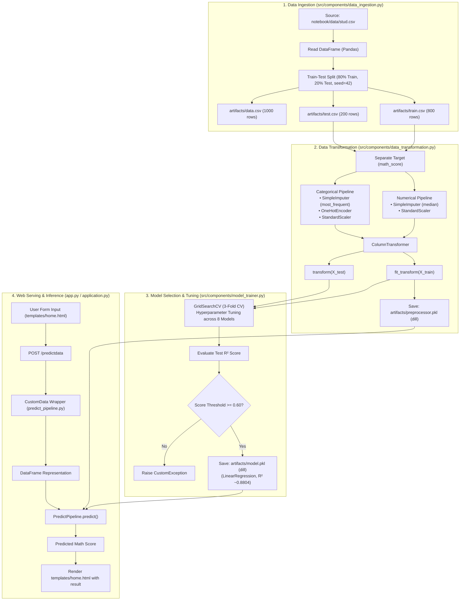

<div align="center">

# Student Exam Performance Indicator
### End-to-End Modular Machine Learning Pipeline & Web Application

[](https://www.python.org/)
[](https://scikit-learn.org/)
[](https://flask.palletsprojects.com/)
[](https://aws.amazon.com/elasticbeanstalk/)
[](https://github.com/Rohitk69992/ML-Projects)

<p align="center">
  A production-structured regression system designed to analyze and predict student mathematics performance based on demographic, socioeconomic, and academic preparation indicators.
</p>

[Overview](#project-overview) •
[Architecture](#system-architecture) •
[ML Workflow](#machine-learning-workflow) •
[Evaluation](#model-evaluation--benchmarks) •
[Installation](#installation--local-setup) •
[Execution](#running-the-project) •
[Deployment](#deployment-configuration) •
[System Notes](#technical-notes--limitations)

---

</div>

<a id="project-overview"></a>
## 📌 Project Overview

This repository demonstrates the transition of an exploratory data science project into an **industry-standard, modular machine learning software package**. 

Rather than relying on isolated Jupyter notebooks, this project implements an end-to-end engineering architecture featuring:
- **Decoupled Pipeline Components:** Independent modules for data ingestion, data transformation, and model training with strict separation of concerns.
- **Robust Feature Engineering:** Leak-free preprocessing pipelines utilizing median/mode imputation, one-hot encoding, and standard scaling orchestrated via `ColumnTransformer`.
- **Systematic Model Benchmarking:** Automated 3-fold cross-validation grid search (`GridSearchCV`) across 8 diverse regression algorithms (Linear, Ensembles, Boosting, Trees, and Neighbors).
- **Persistent Artifact Serialization:** Standalone preprocessor and trained estimator pipelines serialized via `dill` for reliable inference.
- **Production-Ready Serving Layer:** A dual-entry Flask application (`app.py` and `application.py`) wired for both local development and deployment on **AWS Elastic Beanstalk**.
- **Enterprise Utilities:** Custom exception handling tracking traceback frames and timestamped logger modules for execution auditing.

---

<a id="problem-statement--dataset"></a>
## 🎯 Problem Statement & Dataset

### Problem Definition
Academic performance is influenced by a combination of socio-demographic factors and foundational skills. The objective of this project is to model and predict a student's **Mathematics score** (`math_score`, continuous scale from 0 to 100) using demographic background, parental education, lunch subsidies, test preparation history, and complementary test performance (reading and writing scores).

### Dataset Attributes
The model is trained on the verified [Students Performance in Exams](https://www.kaggle.com/datasets/spscientist/students-performance-in-exams?datasetId=74977) dataset (`notebook/data/stud.csv`).

| Feature Name | Feature Type | Values / Range | Description |
| :--- | :--- | :--- | :--- |
| `gender` | Categorical | `female`, `male` | Gender of the student |
| `race_ethnicity` | Categorical | `group A`, `group B`, `group C`, `group D`, `group E` | Anonymized ethnic group designation |
| `parental_level_of_education` | Categorical | `some high school`, `high school`, `some college`, `associate's degree`, `bachelor's degree`, `master's degree` | Highest degree attained by parents |
| `lunch` | Categorical | `standard`, `free/reduced` | Type of lunch subsidy (socioeconomic proxy) |
| `test_preparation_course` | Categorical | `none`, `completed` | Test preparation course status |
| `reading_score` | Numerical | `0` to `100` | Score achieved in reading exam |
| `writing_score` | Numerical | `0` to `100` | Score achieved in writing exam |
| **`math_score`** *(Target)* | Numerical | `0` to `100` | Score achieved in mathematics exam |

*Dataset Quality Audit:* The raw dataset comprises **1,000 instances** and **8 total columns**. Audits confirm **0 missing values** and **0 duplicate entries**.

---

<a id="system-architecture"></a>
## 🏗️ System Architecture

The project follows a modular lifecycle architecture where raw data is ingested, processed through a leak-proof transformer, fitted across candidate algorithms, serialized, and served through a lightweight Flask API:



---

<a id="machine-learning-workflow"></a>
## ⚙️ Machine Learning Workflow

### 1. Data Ingestion (`src/components/data_ingestion.py`)
- Reads raw records from `notebook/data/stud.csv`.
- Generates the raw artifact export at `artifacts/data.csv`.
- Executes a reproducible 80/20 train-test split (`test_size=0.2`, `random_state=42`).
- Serializes split partitions to `artifacts/train.csv` and `artifacts/test.csv`.

### 2. Data Transformation (`src/components/data_transformation.py`)
To prevent data leakage, transformer statistics are learned strictly from the training partition:
- **Numerical Features** (`reading_score`, `writing_score`):
  1. `SimpleImputer(strategy='median')`: Replaces missing numeric values with the column median.
  2. `StandardScaler()`: Standardizes features by centering to zero mean and scaling to unit variance.
- **Categorical Features** (`gender`, `race_ethnicity`, `parental_level_of_education`, `lunch`, `test_preparation_course`):
  1. `SimpleImputer(strategy='most_frequent')`: Imputes modal category for missing values.
  2. `OneHotEncoder(sparse_output=False)`: Encodes categorical variables into binary indicator vectors.
  3. `StandardScaler()`: Standardizes encoded categorical representation.
- Pipelines are packaged into a unified `ColumnTransformer` and serialized to `artifacts/preprocessor.pkl`.

### 3. Model Training & Selection (`src/components/model_trainer.py`)
- Evaluates 8 distinct regression estimators under `GridSearchCV` with 3-fold cross-validation:
  - Linear Regression
  - Decision Tree Regressor
  - Random Forest Regressor
  - Gradient Boosting Regressor
  - K-Neighbors Regressor
  - XGBoost Regressor (`XGBRegressor`)
  - CatBoost Regressor (`CatBoostRegressor`)
  - AdaBoost Regressor
- Identifies the top-performing estimator based on test set $R^2$ score.
- Enforces an automated quality gate (`best_model_score >= 0.6`).
- Serializes the champion estimator to `artifacts/model.pkl`.

---

<a id="model-evaluation--benchmarks"></a>
## 📊 Model Evaluation & Benchmarks

The models were evaluated on the held-out test split (200 instances) using Root Mean Squared Error (RMSE), Mean Absolute Error (MAE), and Coefficient of Determination ($R^2$). 

The following benchmark metrics are verified directly from empirical test runs documented in [`notebook/2. MODEL TRAINING.ipynb`](notebook/2.%20MODEL%20TRAINING.ipynb):

| Rank | Model Name | Training $R^2$ | Test $R^2$ Score | Test RMSE | Test MAE |
| :---: | :--- | :---: | :---: | :---: | :---: |
| 🥇 | **Ridge Regression** | 0.8743 | **0.8806** | **5.3904** | **4.2111** |
| 🥈 | **Linear Regression** *(Selected)* | 0.8743 | **0.8804** | **5.3940** | **4.2148** |
| 🥉 | **CatBoost Regressor** | 0.9589 | **0.8516** | 6.0086 | 4.6125 |
| 4 | **Random Forest Regressor** | 0.9761 | **0.8511** | 6.0195 | 4.6350 |
| 5 | **AdaBoost Regressor** | 0.8500 | **0.8477** | 6.0868 | 4.7217 |
| 6 | **XGBoost Regressor** | 0.9955 | **0.8278** | 6.4733 | 5.0577 |
| 7 | **Lasso Regression** | 0.8071 | **0.8253** | 6.5197 | 5.1579 |
| 8 | **K-Neighbors Regressor** | 0.8555 | **0.7838** | 7.2530 | 5.6210 |
| 9 | **Decision Tree Regressor** | 0.9997 | **0.7596** | 7.6482 | 6.1450 |

### Key ML Findings & Selection Rationale
- **Linearity in Feature Relationships:** Linear models (Ridge and Linear Regression) outscored complex non-linear ensemble models (Random Forest, XGBoost) on this problem. The strong underlying correlation between reading, writing, and math scores creates a smooth hyper-plane that linear models capture cleanly without variance inflation.
- **Overfitting in Tree Ensembles:** Unconstrained Decision Trees and XGBoost exhibited near-perfect training scores ($R^2 \approx 0.999$ and $0.995$) but dropped to $0.759$ and $0.827$ on unseen test data, demonstrating overfitting on this sample size.
- **Production Choice:** `LinearRegression()` achieved an optimal balance of generalization ($R^2 \approx 0.8804$), low inference latency, minimal memory footprint, and high interpretability.

---

<a id="technology-stack"></a>
## 🛠️ Technology Stack

| Category | Technology | Usage in Repository |
| :--- | :--- | :--- |
| **Language** | Python 3.8+ / 3.11+ | Primary programming language |
| **Data Processing** | `pandas`, `numpy` | Dataframe manipulation, matrix transformation |
| **Machine Learning** | `scikit-learn` | Preprocessing (`Pipeline`, `ColumnTransformer`), tuning (`GridSearchCV`), estimators, metrics |
| **Advanced Gradient Boosting** | `xgboost`, `catboost` | Gradient boosting benchmark regressors |
| **Model Persistence** | `dill` | Serialization of composite preprocessing pipelines and models |
| **Web Framework** | `Flask`, `Jinja2` | Web server routes, request handling, dynamic HTML template rendering |
| **Deployment / WSGI** | AWS Elastic Beanstalk | Server configuration (`.ebextensions/python.config`), WSGI entry point |
| **Packaging** | `setuptools` | Setup script (`setup.py`) with automatic package discovery (`find_packages`) |
| **Exploration & EDA** | `matplotlib`, `seaborn`, `jupyter` | Distribution plots, bivariate analysis, correlation matrices |

---

<a id="repository-structure"></a>
## 📂 Repository Structure

```
ML-Projects/
├── .ebextensions/
│   └── python.config            # AWS Elastic Beanstalk WSGI configuration
├── artifacts/
│   ├── data.csv                 # Ingested raw dataset snapshot (1,000 records)
│   ├── train.csv                # Training dataset partition (800 records)
│   ├── test.csv                 # Testing dataset partition (200 records)
│   ├── preprocessor.pkl         # Serialized fitted ColumnTransformer pipeline
│   └── model.pkl                # Serialized champion model (LinearRegression)
├── notebook/
│   ├── data/
│   │   └── stud.csv             # Primary student performance source data
│   ├── 1 . EDA STUDENT PERFORMANCE .ipynb  # Comprehensive exploratory data analysis
│   └── 2. MODEL TRAINING.ipynb  # Benchmark experiments & hyperparameter sweeps
├── src/
│   ├── __init__.py              # Package marker
│   ├── exception.py             # CustomException capturing detailed script & line info
│   ├── logger.py                # Timestamped logging utility
│   ├── utils.py                 # Utilities (save_object, load_object, evaluate_model)
│   ├── components/
│   │   ├── __init__.py
│   │   ├── data_ingestion.py    # Ingestion component & pipeline execution entry
│   │   ├── data_transformation.py # Pipeline assembly & feature transformer
│   │   └── model_trainer.py     # GridSearchCV training & model evaluation logic
│   └── pipeline/
│       ├── __init__.py
│       ├── predict_pipeline.py  # Inference pipeline & CustomData form mapper
│       └── train_pipeline.py    # Pipeline interface module
├── templates/
│   ├── index.html               # Welcome landing page
│   └── home.html                # Prediction form and result display interface
├── .gitignore                   # Ignore rules for environments, artifacts & logs
├── app.py                       # Local Flask development application entry point
├── application.py               # WSGI application entry point for AWS Elastic Beanstalk
├── README.md                    # Project documentation
├── requirements.txt             # Project library dependencies
└── setup.py                     # Package distribution & metadata configuration
```

---

<a id="installation--local-setup"></a>
## 💻 Installation & Local Setup

### Prerequisites
- Python 3.8+ (tested on Python 3.11)
- Git command-line tools

### Step 1: Clone the Repository
```bash
git clone https://github.com/Rohitk69992/ML-Projects.git
cd ML-Projects
```

### Step 2: Create and Activate a Virtual Environment
- **On Windows (PowerShell):**
  ```powershell
  python -m venv venv
  .\venv\Scripts\Activate.ps1
  ```
- **On macOS / Linux:**
  ```bash
  python3 -m venv venv
  source venv/bin/activate
  ```

### Step 3: Install Required Dependencies
Install the verified dependencies listed in `requirements.txt`:
```bash
pip install -r requirements.txt
```

### Step 4: Install Local Package in Editable Mode
To make `src` resolvable across all entry points, install the package in editable mode:
```bash
pip install -e .
```

---

<a id="running-the-project"></a>
## 🚀 Running the Project

### Option A: Retrain the Pipeline
To re-run data ingestion, split the dataset, build the preprocessor, perform the hyperparameter search, and export fresh artifacts to `artifacts/`:

```bash
python src/components/data_ingestion.py
```

*Expected Terminal Output:*
```text
[Timestamp] INFO - Entered the data ingestion method or component
[Timestamp] INFO - Read the dataset as DataFrame
[Timestamp] INFO - Train test split initiated
[Timestamp] INFO - Ingestion of the data is completed
[Timestamp] INFO - Applying preprocessing object on the training and testing dataframe
[Timestamp] INFO - Saving preprocessing object
[Timestamp] INFO - Best found model on both training and testing dataset
0.880433...
```

### Option B: Run the Web Application
Start the Flask web server locally:

```bash
python app.py
```
*(Alternatively, `python application.py` can be executed, as both share the same WSGI entry points).*

The server will initialize at `http://localhost:5000` (or `http://127.0.0.1:5000`):
- **Landing Page:** `http://localhost:5000/`
- **Prediction UI:** `http://localhost:5000/predictdata`

---

<a id="usage--prediction-example"></a>
## 🧪 Usage & Prediction Example

### 1. Web Interface Flow
1. Navigate to `http://localhost:5000/predictdata` in your browser.
2. Select student demographic attributes:
   - **Gender:** `Female`
   - **Ethnicity:** `Group B`
   - **Parental Education:** `Associate's degree`
   - **Lunch Type:** `Standard`
   - **Test Prep Course:** `Completed`
   - **Reading Score:** `72`
   - **Writing Score:** `74`
3. Click **"Predict your Maths Score"**.
4. The predicted score is dynamically computed and rendered in the result header.

### 2. Programmatic Python Execution
You can also run inference directly within Python scripts using the verified `CustomData` and `PredictPipeline` modules:

```python
from src.pipeline.predict_pipeline import CustomData, PredictPipeline

# 1. Instantiate sample student data
sample_student = CustomData(
    gender="female",
    race_ethnicity="group B",
    parental_level_of_education="some college",
    lunch="standard",
    test_preparation_course="none",
    reading_score=72,
    writing_score=74
)

# 2. Convert to DataFrame schema matching training format
features_df = sample_student.get_data_as_data_frame()

# 3. Predict via serialized pipeline
pipeline = PredictPipeline()
prediction = pipeline.predict(features_df)

print(f"Predicted Mathematics Score: {prediction[0]:.2f}")
# Output: Predicted Mathematics Score: 67.83
```

---

<a id="deployment-configuration"></a>
## ☁️ Deployment Configuration

The repository includes deployment specifications designed for **AWS Elastic Beanstalk (Python Platform)**:

1. **WSGI Configuration (`.ebextensions/python.config`):**
   ```yaml
   option_settings:
     "aws:elasticbeanstalk:container:python":
       WSGIPath: application:application
   ```
2. **Dual Entrypoint Architecture:**
   - In AWS Elastic Beanstalk's Python environment, the WSGI container looks for a top-level file named `application.py` exposing a callable named `application`.
   - `application.py` defines `application = Flask(__name__)` and `app = application`, ensuring zero-configuration compatibility with Elastic Beanstalk WSGI workers.
   - `app.py` is preserved for conventional local Flask runs.

> [!NOTE]
> *Deployment Status:* The repository contains the necessary configuration files for AWS Elastic Beanstalk deployment. No live public domain is currently maintained or hosted by the repository.

---

<a id="technical-notes--limitations"></a>
## 🔍 Technical Notes & Limitations

For full transparency, the following technical details and considerations from the repository audit are documented below:

1. **Form Input Naming Inversion:**
   - In `templates/home.html`, the input field labelled *"Writing Score out of 100"* uses `name="reading_score"`, while the field labelled *"Reading Score out of 100"* uses `name="writing_score"`.
   - In `app.py` / `application.py`, the backend reads `reading_score=float(request.form.get('writing_score'))` and `writing_score=float(request.form.get('reading_score'))`.
   - While the values map correctly end-to-end due to the corresponding reversal in the controller, this represents a known field-naming inconsistency between markup and backend.
2. **OneHotEncoder Handling of Unseen Categories:**
   - The categorical pipeline in `data_transformation.py` initializes `OneHotEncoder(sparse_output=False)` with default parameter `handle_unknown='error'`. If a category outside the training domains is submitted, a `ValueError` wrapped in `CustomException` will be raised.
3. **Pipeline Orchestration:**
   - Currently, `src/pipeline/train_pipeline.py` is an empty interface file. End-to-end retraining is triggered via the `__main__` entry point of `src/components/data_ingestion.py`.
4. **Log File Directory Nesting:**
   - In `src/logger.py`, log files are placed in `logs/<timestamp>.log/<timestamp>.log` due to creating a directory with the log file name and writing the log file inside it.

---

<a id="roadmap--future-improvements"></a>
## 🔮 Roadmap & Future Improvements

- [ ] **Decoupled Training Pipeline:** Move the training orchestration logic from `data_ingestion.py` into `src/pipeline/train_pipeline.py` with CLI argument parsing (`argparse` / `click`).
- [ ] **Input Validation:** Introduce schema validation via `Pydantic` to validate incoming requests and handle boundary exceptions gracefully.
- [ ] **Containerization:** Add a multi-stage `Dockerfile` and `docker-compose.yml` to simplify container-based deployments.
- [ ] **CI/CD Integration:** Set up GitHub Actions workflows for automated linting (`flake8`), formatting (`black`), and testing (`pytest`).
- [ ] **Handling Unknown Categories:** Update `OneHotEncoder` configuration with `handle_unknown='ignore'` to improve inference resilience against unexpected input tokens.

---

<a id="contributing"></a>
## 🤝 Contributing

Contributions to improve data pipelines, UI design, or test coverage are welcome!

1. Fork the Project (`https://github.com/Rohitk69992/ML-Projects/fork`)
2. Create your Feature Branch (`git checkout -b feature/ImprovedPipeline`)
3. Commit your Changes (`git commit -m 'Add ImprovedPipeline feature'`)
4. Push to the Branch (`git push origin feature/ImprovedPipeline`)
5. Open a Pull Request

---

<a id="license"></a>
## 📄 License

This repository does not currently include an explicit open-source license file. All rights are retained by the author. For inquiries regarding reuse, modification, or commercial application, please contact the repository owner.

---

<a id="author--acknowledgements"></a>
## 👨‍💻 Author & Acknowledgements

- **Developer:** [Rohit](https://github.com/Rohitk69992)
- **GitHub Repository:** [Rohitk69992/ML-Projects](https://github.com/Rohitk69992/ML-Projects)
- **Dataset Attribution:** [spscientist](https://www.kaggle.com/datasets/spscientist/students-performance-in-exams) on Kaggle for the public Student Performance dataset.

<div align="center">
  <sub>Maintained by Rohit • Built with Python, Scikit-Learn & Flask</sub>
</div>
